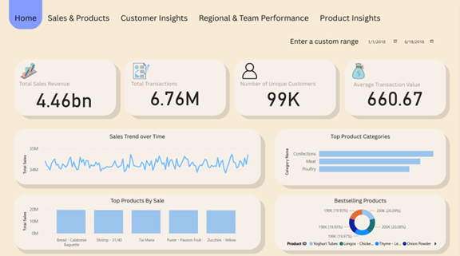

# Grocery Sales Dashboard

A five-page Power BI report for exploring grocery sales through products, customers, locations, and salespeople. The repository includes the editable report and semantic model, a home-page preview, and a PDF you can read without Power BI.



[View the report PDF](assets/report.pdf) · [Open the Power BI project](Grocery%20Sales%20Dashboard.pbip)

## A tour of the report

| Page | Focus |
| --- | --- |
| Home | Starting point for the report and page navigation |
| Sales & Products | Sales activity and product comparisons |
| Customer Insights | Customers and purchasing behavior |
| Regional & Team Performance | Geographic and salesperson views |
| Product Insights | Product-level exploration |

## How the model works

Power Query imports seven CSV sources: `sales`, `products`, `customers`, `employees`, `categories`, `cities`, and `countries`. Relationships connect sales to customers, products, and salespeople; cities and countries provide geographic context.

The `Product Sales` query joins sales to product prices and calculates each row's discounted value:

```text
Total Cost = Quantity × Price × (1 − Discount / 100)
```

The supplied DAX measures include average price, average transaction value, distinct purchasing customers, average purchase, and average sales per employee. Their exact definitions live in the [semantic model tables](Grocery%20Sales%20Dashboard.SemanticModel/definition/tables).

For example, `Average_Transaction_Value` divides the sum of `Total Cost` by the count of `sales[SalesID]`. That is the implemented definition; it does not count distinct `TransactionNumber` values. Interpret report figures with the model's row granularity and filters in mind.

## Open and refresh

For a quick look, open the [PDF](assets/report.pdf) or the preview above. To edit or refresh the report:

1. Clone or download this repository, keeping the report and semantic-model folders together.
2. Open `Grocery Sales Dashboard.pbip` in Power BI Desktop with support for the included PBIP/PBIR/TMDL formats.
3. Obtain the seven source CSV files listed below. They are **not included** in this repository.
4. In Power Query, update the local file locations used by the source queries. Check both the `products` query and `products (2)`, along with the other CSV queries.
5. Apply the changes, refresh the model, and check the report pages and relationships against your data.

| Required file | Used for |
| --- | --- |
| `sales.csv` | Sales rows, quantities, discounts, and dates |
| `products.csv` | Product names, prices, and category IDs |
| `customers.csv` | Customer details and city IDs |
| `employees.csv` | Salesperson details |
| `categories.csv` | Product category names |
| `cities.csv` | City names and country IDs |
| `countries.csv` | Country names and codes |

The queries currently refer to an author-local folder. Refresh will fail until these paths point to your copies of the files with the expected columns and data types. The repository does not include the imported data cache, so cloning it alone does not reproduce the populated report. The saved preview and PDF remain available for inspection.

## Data source

The grocery dataset was obtained from **Kaggle**. The original dataset page and license were not recorded in this repository, so an exact source link is unavailable. The report definitions, preview, and PDF are included here; the raw CSVs are not redistributed.

## Repository layout

| Path | Contents |
| --- | --- |
| [`Grocery Sales Dashboard.pbip`](Grocery%20Sales%20Dashboard.pbip) | Power BI project entry point |
| [`Grocery Sales Dashboard.Report/`](Grocery%20Sales%20Dashboard.Report) | Pages, visuals, and report configuration |
| [`Grocery Sales Dashboard.SemanticModel/`](Grocery%20Sales%20Dashboard.SemanticModel) | Tables, relationships, Power Query, and DAX |
| [`assets/`](assets) | Home-page screenshot and report PDF |

**Tools:** Power BI Desktop · Power Query (M) · DAX · PBIP/PBIR · TMDL · CSV
